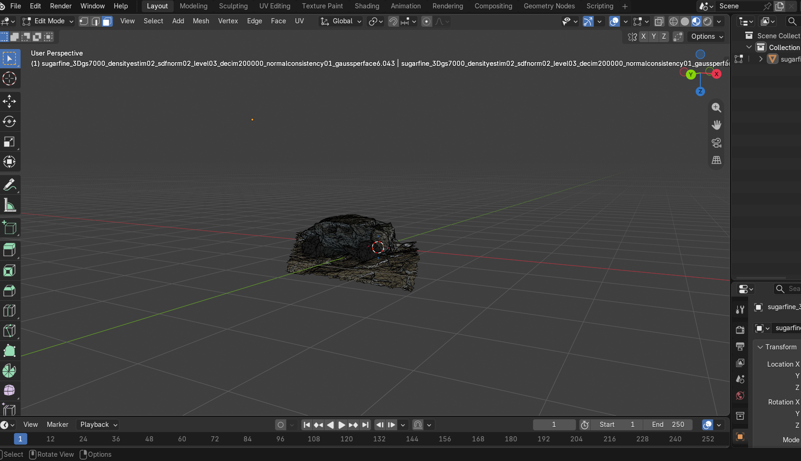

# 3D Gaussian Splatting to Mesh Pipeline

I wanted to run Gaussian Splatting end to end on my own captures instead of only reading the papers. The first goal was a clean novel-view reconstruction. The second was getting a real surface mesh out of it, because a splat is a cloud of blobs and most tools want triangles.

My background is multi-sensor calibration and point cloud work (camera, LiDAR, radar, 3D-2D and 3D-3D projections) in autonomous driving. This project sits in the same geometry space.

Everything here ran locally on an RTX 3060 laptop (6 GB) under WSL2.

---

## What's in this repo

Two pipelines that share COLMAP at the front and then split:

```
capture (phone video / turntable photos)
   │
   ▼
COLMAP structure-from-motion
   │
   ├─ Pipeline 1 ─ nerfstudio splatfacto ──► flythrough video
   │
   └─ Pipeline 2 ─ vanilla Inria 3DGS ──► SuGaR (coarse → fine)
                                            ──► textured mesh ──► Blender cleanup
```


Pipeline 1 is the one I learned on, and it has a one-command script in this repo. 
Pipeline 2 is the splat to surface mesh path.

---

## Pipeline 1: novel views

https://github.com/user-attachments/assets/b4bd633f-37be-48ca-964d-a8f218b5abb8

This was reconstructed from about 2 minutes of handheld phone video of a Groot figure. The steps are frames, COLMAP through `ns-process-data`, `ns-train splatfacto`, then render.

```
video (.mp4)
   │  ffmpeg
   ▼
image set (~150–300 frames)
   │  COLMAP (nerfstudio ns-process-data)
   ▼
posed images
   │  ns-train splatfacto
   ▼
trained splat
   │  ns-render
   ▼
flythrough
```

### Quick start (Pipeline 1)

```bash
git clone https://github.com/Pruthvi-Radadiya/gaussian-splatting-pipeline.git
cd gaussian-splatting-pipeline
chmod +x run_pipeline.sh
./run_pipeline.sh path/to/your_video.mp4 scene_name
```

You need an NVIDIA GPU (6 GB or more), nerfstudio, COLMAP and ffmpeg. I use `--pipeline.datamanager.camera-res-scale-factor 0.5` so training fits in 6 GB of VRAM. If you have more headroom, change it in `run_pipeline.sh`.

---

## Pipeline 2 - Hot Wheels → SuGaR mesh

A splat looks like the object from new angles, but it is still a cloud of blobs. Unity, physics, and most sim tools want triangles. For that I ran [SuGaR](https://github.com/Anttwo/SuGaR) (surface-aligned Gaussian Splatting) on a Hot Wheels car:

1. Short vanilla 3DGS (Inria layout, ~7k iters) so Gaussians roughly find the car  
2. SuGaR coarse training (pull blobs onto the surface)  
3. Poisson mesh extract  
4. SuGaR fine / refine (`sugarfine_...`) with texture export  
5. Open in Blender, clean up table junk / normals

### Results

Textured export:


Same mesh in Edit Mode (topology):



Both are the refined SuGaR output (`sugarfine_3Dgs7000_..._decim200000_...`), not a quick Poisson dump from splatfacto.

### Things that actually blocked me (and how I fixed them)

**nerfstudio checkpoint ≠ what SuGaR wants.**  
I first tried feeding a splatfacto checkpoint into SuGaR. The format and coordinate conventions don't match the Inria 3DGS layout that SuGaR builds on. I retrained a separate vanilla 3DGS model in the original Inria pipeline and gave that to SuGaR.

**Camera model.**  
COLMAP produced OPENCV cameras, which include lens distortion. SuGaR and Inria 3DGS expect PINHOLE, so I ran the standard undistort step first.

**CUDA / build pain on WSL.**  
My system toolkit was 12.x and the 3DGS and SuGaR code wanted 11.8. I put everything in a conda environment, compiled the custom CUDA rasterization extensions from source, and worked through missing runtime libraries and GCC/glibc mismatches until `diff-gaussian-rasterization` built and ran.

### Honest take on mesh quality

Not great. The car is small and shiny, and I reconstructed the whole scene, table included, instead of masking out the object. You can see leftover ground and bumpy noise on the surface. I think this comes mostly from how I captured it, so the next shoot needs tighter framing, less glare and a cleaner background.

---

## Stack

- [nerfstudio](https://docs.nerf.studio/) (`splatfacto` / gsplat) - Pipeline 1  
- [Inria 3D Gaussian Splatting](https://github.com/graphdeco-inria/gaussian-splatting) - vanilla model for SuGaR  
- [SuGaR](https://github.com/Anttwo/SuGaR) - surface align + mesh extract - Pipeline 2  
- COLMAP - SfM / poses  
- PyTorch + CUDA (11.8 in the training envs; system had 12.4)  
- ffmpeg, Blender  
- Hardware: RTX 3060 6GB, WSL2 Ubuntu

---

## What I took away

- Capture quality and COLMAP registration matter more than training settings. When fewer than about 85% of images registered, I got artifacts that more iterations did not fix.
- Half-resolution inputs (`camera-res-scale-factor 0.5`) were enough to avoid running out of memory on 6 GB.
- A splat that looks right from new angles and a mesh you can collide with are different products. SuGaR was my bridge, and getting the toolchains to agree took about half the total time.
- The mesh quality here is limited by the object's size, its shine, and reconstructing the whole table, more than by SuGaR settings.

---

## Status / next

- [x] Video → splatfacto flythrough  
- [x] Photos → vanilla 3DGS → SuGaR refined mesh → Blender  
- [ ] Fail-fast check on COLMAP registration before burning a full train  
- [ ] Cleaner object-centric capture and a second mesh pass  
- [ ] Eventually try the mesh / twin path in a sim stack (Isaac / Omniverse) - not done yet

Upstream SuGaR and Inria 3DGS are their own repos with their own licenses. This repo documents the pipeline I ran and ships the Pipeline 1 helper script + result visuals.
