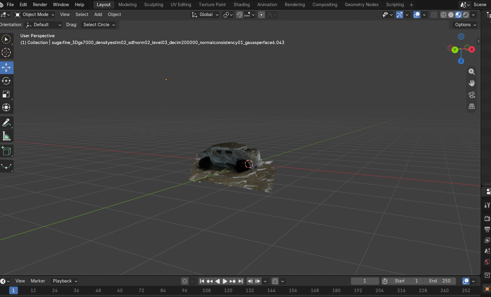

# 3D Gaussian Splatting → Mesh Extraction Pipeline

I started this wanting to go beyond papers on Gaussian Splatting — actually run the stack end to end on my own captures. First goal was a solid novel-view reconstruction. Second was getting a real surface mesh out of it, not just pretty fog.

Background: multi-sensor calibration and point cloud work (camera / LiDAR / radar, 3D–2D and 3D–3D projections) from autonomous perception. This project sits in that same geometry space.

Everything below ran locally on an RTX 3060 laptop (6GB) under WSL2.

---

## What this repo covers

Two related pipelines that share COLMAP at the front, then diverge:

```
capture (phone video / turntable photos)
   │
   ▼
COLMAP structure-from-motion
   │
   ├─ Pipeline 1 ─ nerfstudio splatfacto ──► flythrough video
   │
   └─ Pipeline 2 ─ vanilla Inria 3DGS ──► SuGaR (coarse → fine)
                                            ──► textured mesh ──► Blender cleanup
```

Pipeline 1 is the learning path and the scripted demo in this repo.  
Pipeline 2 is the part that matches what I put on my CV: splat → surface mesh.

---

## Demo — Pipeline 1 (novel views)

https://github.com/user-attachments/assets/b4bd633f-37be-48ca-964d-a8f218b5abb8

Reconstructed from ~2 minutes of handheld phone video (Groot figure). Frames → COLMAP via `ns-process-data` → `ns-train splatfacto` → render.

```
video (.mp4)
   │  ffmpeg
   ▼
image set (~150–300 frames)
   │  COLMAP (nerfstudio ns-process-data)
   ▼
posed images
   │  ns-train splatfacto
   ▼
trained splat
   │  ns-render
   ▼
flythrough
```

### Quick start (Pipeline 1)

```bash
git clone https://github.com/Pruthvi-Radadiya/gaussian-splatting-pipeline.git
cd gaussian-splatting-pipeline
chmod +x run_pipeline.sh
./run_pipeline.sh path/to/your_video.mp4 scene_name
```

Needs NVIDIA GPU (6GB+), nerfstudio, COLMAP, ffmpeg. I use `--pipeline.datamanager.camera-res-scale-factor 0.5` so training fits in 6GB VRAM — tweak that in `run_pipeline.sh` if you have more headroom.

---

## Pipeline 2 — Hot Wheels → SuGaR mesh

A splat looks like the object from new angles, but it is still a cloud of blobs. Unity, physics, and most sim tools want triangles. For that I ran [SuGaR](https://github.com/Anttwo/SuGaR) (surface-aligned Gaussian Splatting) on a Hot Wheels car:

1. Short vanilla 3DGS (Inria layout, ~7k iters) so Gaussians roughly find the car  
2. SuGaR coarse training (pull blobs onto the surface)  
3. Poisson mesh extract  
4. SuGaR fine / refine (`sugarfine_...`) with texture export  
5. Open in Blender, clean up table junk / normals

### Results

Textured export:



Same mesh in Edit Mode (topology):


Both are the refined SuGaR output (`sugarfine_3Dgs7000_..._decim200000_...`), not a quick Poisson dump from splatfacto.

### Things that actually blocked me (and how I fixed them)

**nerfstudio checkpoint ≠ what SuGaR wants.**  
I first tried feeding a splatfacto / nerfstudio checkpoint into SuGaR. Format and coordinate conventions do not line up with the Inria 3DGS layout SuGaR wraps. Fix: retrain a dedicated vanilla 3DGS model in the original Inria pipeline, then hand that to SuGaR.

**Camera model.**  
COLMAP was giving OPENCV cameras. SuGaR / Inria 3DGS expect PINHOLE after undistortion. Ran the standard undistort step so the scene matched what the rasterizer assumes.

**CUDA / build pain on WSL.**  
System toolkit was 12.x while the 3DGS / SuGaR path wanted 11.8-era builds. Isolated everything in conda, compiled the custom CUDA rasterization extensions from source, and chased missing runtime libs / GCC–glibc mismatches until `diff-gaussian-rasterization` actually linked and ran.

### Honest take on mesh quality

The car is small, shiny, and I reconstructed the whole scene (table included), not a tightly masked object. You can see leftover ground and some bumpy surface noise in the screenshots. That is less a hyperparameter problem and more a capture / scene-scope problem — useful signal for the next shoot (tighter framing, less glare, better isolation of the object).

---

## Stack

- [nerfstudio](https://docs.nerf.studio/) (`splatfacto` / gsplat) — Pipeline 1  
- [Inria 3D Gaussian Splatting](https://github.com/graphdeco-inria/gaussian-splatting) — vanilla model for SuGaR  
- [SuGaR](https://github.com/Anttwo/SuGaR) — surface align + mesh extract — Pipeline 2  
- COLMAP — SfM / poses  
- PyTorch + CUDA (11.8 in the training envs; system had 12.4)  
- ffmpeg, Blender  
- Hardware: RTX 3060 6GB, WSL2 Ubuntu

---

## What I took away

- Capture and COLMAP registration beat training knobs. Sub-~85% registration → artifacts no amount of extra iters fix.  
- Half-res inputs (`camera-res-scale-factor 0.5`) were enough to avoid OOM on 6GB.  
- A novel-view splat and a collision-worthy mesh are different products. SuGaR is the bridge I used; interop between toolchains was half the work.  
- Mesh quality on this car is capped by object size, reflectance, and reconstructing the whole table — not just by SuGaR settings.

---

## Status / next

- [x] Video → splatfacto flythrough  
- [x] Photos → vanilla 3DGS → SuGaR refined mesh → Blender  
- [ ] Fail-fast check on COLMAP registration before burning a full train  
- [ ] Cleaner object-centric capture and a second mesh pass  
- [ ] Eventually try the mesh / twin path in a sim stack (Isaac / Omniverse) — not done yet

Upstream SuGaR and Inria 3DGS are their own repos with their own licenses. This repo documents the pipeline I ran and ships the Pipeline 1 helper script + result visuals.
